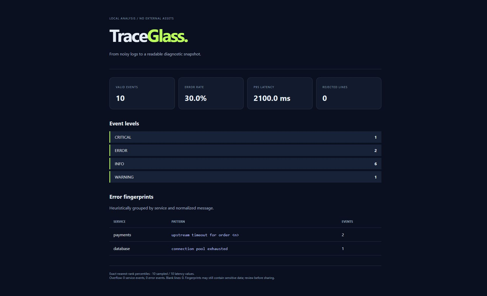

# TraceGlass

**Turn JSONL logs into a readable diagnostic snapshot.**

A local, dependency-free Python CLI for streaming log analysis. Count event levels,
group recurring errors, estimate latency percentiles and export a standalone HTML
report. No server, uploads, analytics or external report assets.



## Quick start

```sh
python traceglass.py demo.jsonl --html report.html
python -m unittest -v
```

Open `report.html` in a browser. The demo contains synthetic events, including two
payment timeouts grouped into one fingerprint. JSON output goes to stdout:

```sh
python traceglass.py demo.jsonl > report.json
python traceglass.py demo.jsonl --strict
python -m pip install .
traceglass demo.jsonl --sample-size 10000 --max-groups 2000
```

Use `-` as the input path to consume stdin. Python 3.11+ is required.

## Input contract

One JSON object per line. UTF-8 files, with optional BOM.

```json
{"level":"ERROR","service":"payments","message":"timeout for order 1042","duration_ms":1500}
```

| Field | Default | Rules |
| --- | --- | --- |
| level | INFO | DEBUG, INFO, WARNING, ERROR, CRITICAL; case-insensitive; WARN/FATAL aliases |
| service | unknown | Nonempty string, up to 200 characters |
| message | empty string | String; first 2,048 characters used for error grouping |
| duration_ms | absent | Optional nonnegative finite number up to 1e15; booleans rejected |

Unknown fields are ignored. Invalid records contribute to rejected-line counts,
never partial event metrics. Blank lines are counted separately. The first ten
validation errors contain line numbers and reasons without echoing raw input.

## Design choices

- **Streaming input:** the CLI reads at most `--max-line-chars + 1` characters at a
  time (default limit: 1 Mi characters). Oversized lines are drained and rejected
  once, keeping later line numbers intact. The limit includes a newline if present.
- **Bounded cardinality:** retain the first `max_groups` services and error
  fingerprints. Known groups keep accumulating; events for new groups go into
  explicit overflow counters. Displayed groups are **not** global heavy-hitter estimates.
- **Reservoir sampling:** retain at most `sample_size` latency observations with a
  fixed random seed. Percentiles use nearest rank and are labeled estimated when
  sampling occurs. Count and maximum are exact; mean is computed incrementally.
- **Explainable grouping:** normalize numbers, UUIDs, email-like strings and a few
  common secret assignments. This is a heuristic, not comprehensive redaction.
- **Safe rendering:** escape untrusted strings before inserting them into HTML.
  Reports have no JavaScript, remote fonts, CDNs or tracking requests.

Memory is O(line limit + sample size + group limit × fingerprint length), independent
of total log length. The iterable Python API assumes each provided string already
fits in memory; use `bounded_lines` for a bounded reader. JSON parser overhead adds
a constant-factor cost within the line limit.

## Output and exit codes

JSON reports include a `schema_version`, counts, error rate, services, grouped errors,
overflow counts, latency statistics and validation examples. JSON is the complete
machine-readable output; HTML presents selected diagnostics.

| Code | Meaning |
| --- | --- |
| 0 | Analysis completed; rejected lines tolerated in default mode |
| 1 | Input, output or configuration error |
| 2 | CLI argument error, or rejected lines under `--strict` |

The input cannot also be the HTML destination. An existing separate HTML output
is overwritten. Review reports before sharing: heuristic fingerprints and service
names may still contain sensitive information.

## Tests and limits

Tests exercise malformed records, exact percentile math, reproducible bounded
sampling, cardinality overflow, HTML injection, oversized lines and CLI behavior.
GitHub Actions tests Python 3.11 and 3.14 on Windows and Linux.

This early 0.1.0 release does not perform trace reconstruction, timestamp windowing,
live tailing or anomaly detection. A percentile sample has no advertised error bound.
Numeric normalization can merge semantically different errors. Reports are a
starting point for investigation, not a root-cause diagnosis.

MIT · [Orçun Kara](https://okdev.tr)
